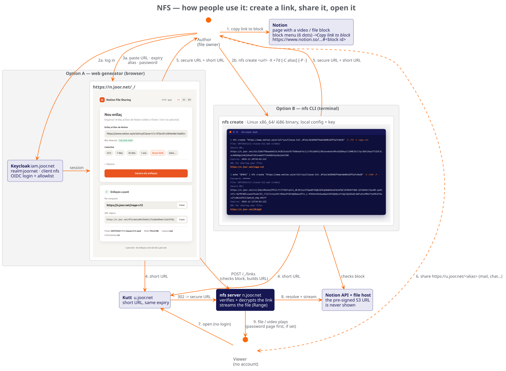
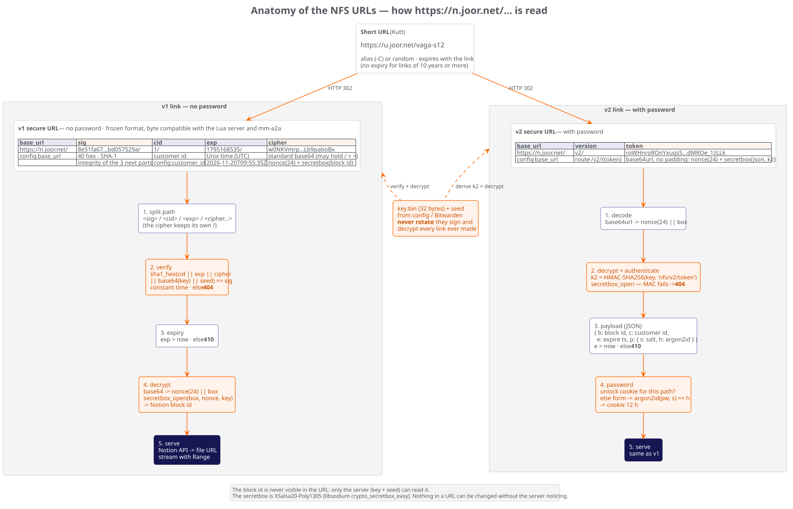
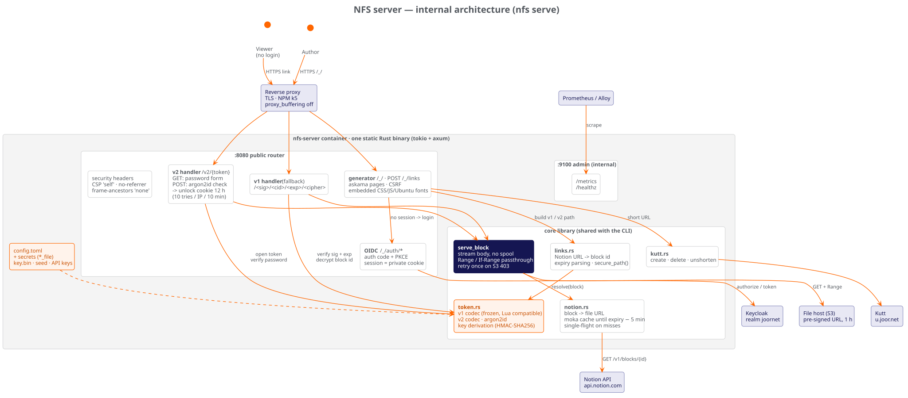
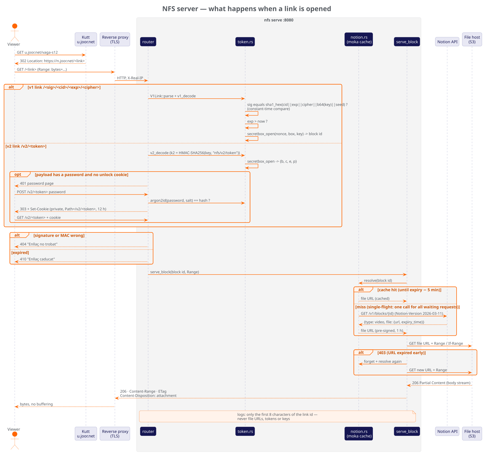
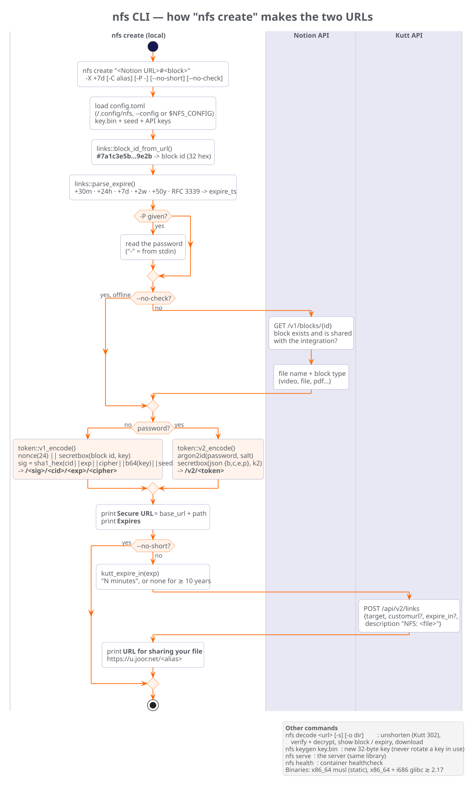

# NFS — Notion File Sharing

[](https://github.com/oriolrius/notion-file-sharing/actions/workflows/ci.yml)
[](https://github.com/oriolrius/notion-file-sharing/releases/latest)
[](https://github.com/users/oriolrius/packages/container/package/notion-file-sharing)

Container image: [`ghcr.io/oriolrius/notion-file-sharing`](https://github.com/users/oriolrius/packages/container/package/notion-file-sharing)
(`docker pull ghcr.io/oriolrius/notion-file-sharing:2`).

Share files and videos stored in Notion with **secure, expiring links**, without making the Notion
page public.

- The link hides the Notion block id (encrypted) and carries an expiry date (signed).
- The server checks the link, asks the Notion API for the file and **streams it** to the client.
  The temporary S3 URL of Notion is never shown.
- A small **web generator** (login with OIDC) turns a Notion "copy link to block" URL into two
  URLs: the secure URL and a short URL (Kutt).
- Optional **password** per link.

One static Rust binary (`nfs`), one ~10 MB container image.



## How it works

```
viewer ──► reverse proxy (TLS) ──► nfs serve
                                     │ 1. verify signature + expiry, decrypt block id
                                     │ 2. Notion API: block → file URL   (cached until it expires)
                                     │ 3. GET file (Range passed through) → stream to the viewer
```

| Link | Format |
|---|---|
| v1 (no password) | `/<sha1 signature>/<customer>/<expire_ts>/<base64 nonce‖secretbox(block_id)>` — byte compatible with the original OpenResty/Lua server |
| v2 (password) | `/v2/<base64url nonce‖secretbox(json)>` — payload has block id, expiry and an argon2id password hash |



### Inside the server





Details: [docs/architecture.md](docs/architecture.md). Diagram sources (PlantUML, oriolrius.me
theme): [docs/diagrams/](docs/diagrams/).

## Usage

### Web generator

Open `https://<server>/_/`, log in, paste the Notion link to the block (block menu ⋮⋮ →
*Copy link to block*), choose the expiry and, optionally, a short alias and a password.

### CLI

Download the binary for your system from the [latest release](https://github.com/oriolrius/notion-file-sharing/releases/latest):

| File | Runs on |
|---|---|
| `nfs-<v>-x86_64-linux-musl` | any x86_64 Linux (static, no libc needed) |
| `nfs-<v>-x86_64-linux-gnu` | x86_64 Linux with glibc ≥ 2.17 (CentOS 7 and newer) |
| `nfs-<v>-i686-linux-gnu` | 32-bit x86 Linux with glibc ≥ 2.17 |

```bash
curl -fLO https://github.com/oriolrius/notion-file-sharing/releases/latest/download/SHA256SUMS
# pick one file, check it, install it
sha256sum --ignore-missing -c SHA256SUMS && install -m 755 nfs-*-x86_64-linux-gnu ~/.local/bin/nfs
```

```bash
nfs create "https://www.notion.so/…#<block_id>" -X +7d            # secure + short URL
nfs create "https://www.notion.so/…#<block_id>" -X +30d -C my-alias -P -   # password from stdin
nfs decode https://u.example.com/abc123 --skip-download            # inspect a link
nfs decode https://u.example.com/abc123 -o ~/Downloads             # download the file
nfs keygen key.bin                                                 # new key (never rotate a key in use)
```



`-X/--expire`: `+30m`, `+24h`, `+7d`, `+2w`, `+50y` or `2026-12-31T23:59:59Z` (default `+50y`).
The short URL gets the same expiry (none for links of 10 years or more).

Configuration: [`config.example.toml`](config.example.toml) → `~/.config/nfs/config.toml`,
`--config`, or `$NFS_CONFIG`.

### Server

```bash
docker run -d --name nfs -p 8080:8080 \
  -v ./config.toml:/etc/nfs/config.toml:ro -v ./secrets:/run/secrets/nfs:ro \
  ghcr.io/oriolrius/notion-file-sharing:2
```

- `:8080` — links, generator (`/_/`), `/healthz`. Publish it behind a TLS reverse proxy.
- `:9100` — `/metrics` (Prometheus) and `/healthz`. Keep it internal.
- The Notion integration must have access to the pages that hold the files.

## Development

```bash
cargo test                       # unit + HTTP tests (Notion/S3/Kutt mocked)
cargo clippy --all-targets -- -D warnings
cargo run -- --config dev.toml serve
uv run --no-project python docs/diagrams/render.py   # docs/diagrams/*.puml -> docs/images/*.svg
```

Releases: conventional commits, `cz bump`, push the tag. GitHub Actions tests, builds and pushes
`ghcr.io/oriolrius/notion-file-sharing:<version>` and creates the GitHub release with the static
binary.

## License

MIT. The Ubuntu fonts in `assets/fonts/` are under the Ubuntu Font Licence 1.0.
